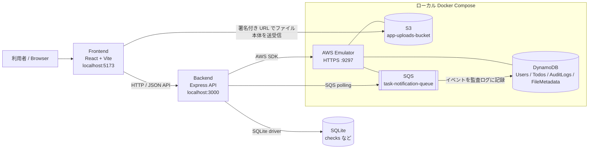
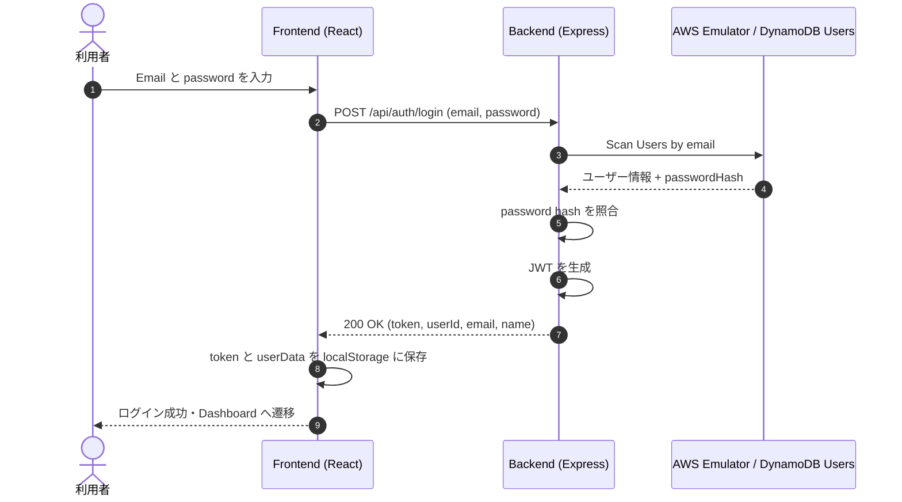
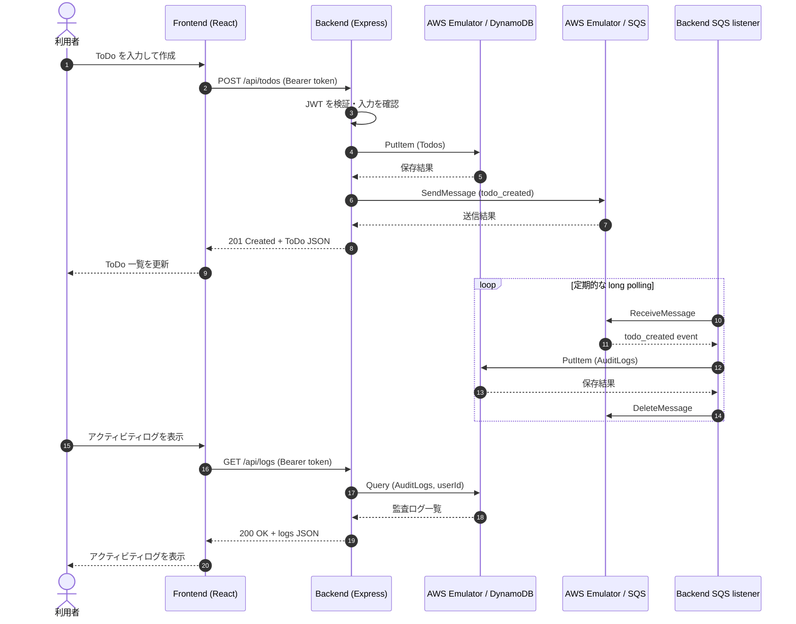
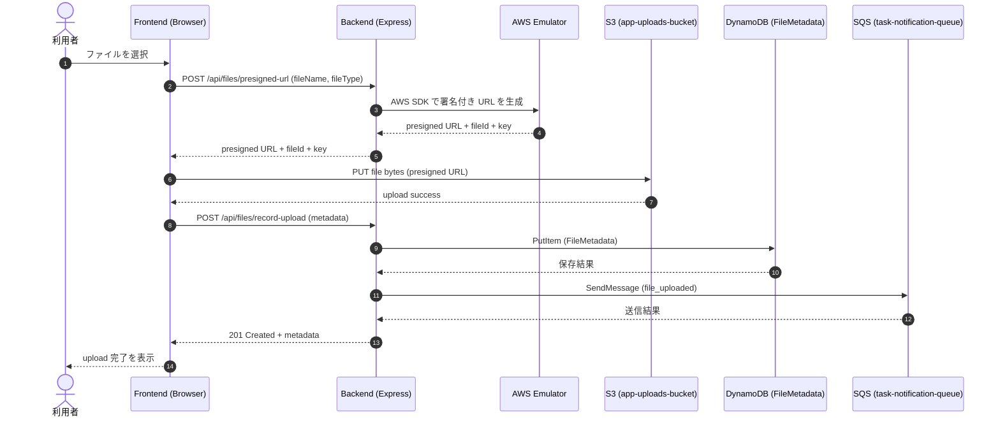

# Copilot Quality Harness 🛠️🤖

**Issue の受け入れ条件から、テスト設計・実装支援・テスト実行・品質レポートまでをつなぐ品質ハーネス**です。Playwright trace の解析や品質ダッシュボードを通じて、開発者の品質確認を支援します。

📊 [品質ダッシュボード](https://cocomomojo.github.io/copilot-quality-harness/dashboard/)　|　📚 [運用フロー](./docs/OPERATION_FLOW.md)　|　🔧 [ワークフローガイド](./docs/WORKFLOWS_GUIDE.md)　|　🧪 [QA Policy](./docs/QA_POLICY.md)

> ⚠️ **開発・テスト用リポジトリです。** AWS Emulator とテスト用エンドポイントを使います。本番環境に公開したり、本番データ・認証情報を使ったりしないでください。

---

## 🧭 1 分で分かる全体像

```text
Issue / 受け入れ条件
  ↓ M2 Issue Intake（Issue のルールベース解析）
テスト観点・項目（ISO/IEC 25010）
  ↓ spec-to-implementation（仕様からテスト生成を支援）
開発者が実装・レビュー
  ↓ Pull Request / Push
Test Matrix（Unit / API job / Playwright E2E）
  ├─ 品質レポート・PR コメント
  ├─ KPI / ダッシュボード更新
  └─ E2E 失敗時の修復支援・trace 解析
  ↓ 人間が結果を確認して判断
マージ・Pages 更新
```

| 用語 | 意味 |
|---|---|
| **Test Matrix** | Unit / API job / E2E を実行し、結果を集約する GitHub Actions workflow |
| **Artifact** | workflow 間で受け渡すテスト結果、品質項目、レポートなどの成果物 |
| **run_id** | Actions 実行ごとの ID。関連する品質データとテスト結果の参照に使います |
| **E2E evidence** | Playwright の trace、スクリーンショット、HTML レポートなどの調査材料 |

M2 Issue Intake はルールベースの判定を行い、生成 AI や外部 API を前提にしません。Copilot を使う分析・提案も、生成結果を人間がレビューする前提です。

---

## 🚀 はじめての方向け

### 標準的な品質ハーネスの流れ

| ステップ | 操作 | 結果・確認先 |
|---:|---|---|
| 1 | Acceptance Template で Issue を作成 | 受け入れ条件・背景・テスト観点を明記 |
| 2 | Actions から `M2 Issue Intake` を実行 | Issue 解析とテスト設計のたたき台 |
| 3 | `Generate Quality Items` を実行 | ISO/IEC 25010 に基づく項目・artifact |
| 4 | 仕様 YAML を確認し `Spec to Implementation` を実行 | 生成されたテストや PR をレビュー |
| 5 | 実装・修正後に PR を更新 | `Test Matrix` と必要な review workflow を確認 |
| 6 | 結果・品質レポートを確認 | Actions、PR コメント、[ダッシュボード](https://cocomomojo.github.io/copilot-quality-harness/dashboard/) |
| 7 | 人間がレビューしてマージ | 変更内容・テスト・セキュリティを確認 |

実行 workflow や入力値は変更される可能性があるため、実際の設定は [`.github/workflows/`](./.github/workflows/) と [運用フローガイド](./docs/OPERATION_FLOW.md) を確認してください。

### Playwright trace の解析フロー

```text
E2E 失敗 → trace / screenshot / log を確認
  ↓ copilot-analyze-trace または E2E healing workflow
trace の解析・原因候補・修正案
  ↓
人間が分析結果と差分を確認 → 修正 → Test Matrix を再実行
```

解析結果はあくまで調査・修正の支援です。自動生成された変更をそのまま採用したり、自動マージしたりせず、差分・テスト結果を人間が確認してください。

---

## 🧩 リポジトリの構成

| パス | 内容 |
|---|---|
| `backend/` | Express API、認証、ToDo・ファイル・ログの API、Backend tests |
| `frontend/` | React + Vite の Web アプリ、Frontend tests |
| `e2e/` | Playwright の E2E テスト |
| `scripts/` | AWS Emulator 起動・初期化、品質検証・レポート生成など |
| `.github/workflows/` | テスト、Issue Intake、品質レポート、trace 解析などの Actions workflow |
| `.github/skills/` | Copilot skills |
| `docs/` | 運用・QA・ダッシュボード・E2E レポートなどのガイド |
| `qa/` | テスト管理、品質特性、ダッシュボード用データ |
| `ops/` | KPI 収集、AWS runtime IAM role 例など |
| `docker-compose.yml` | ローカル AWS Emulator の定義 |
| `playwright.config.js` | Playwright の browser / webServer / reporter 設定 |

### Web アプリの機能

| 領域 | 主な内容 |
|---|---|
| Frontend | ログイン、ダッシュボード、ToDo、ファイル、アクティビティログ |
| Backend | JWT 認証、ToDo API、ファイル API、ログ API、health check |
| AWS 連携 | DynamoDB、S3、SQS を使った開発・テスト。本番 AWS では実行環境の IAM role を利用 |
| SQLite | checks などのローカル用データストア |

### 🏗️ アプリケーション構成図

下図はローカル開発・E2E テスト時のアプリケーションとデータストアの関係です。AWS Emulator は Docker container 内で動作し、Backend から AWS SDK 経由で接続します。



| コンポーネント | 役割 | ローカル接続先・データ |
|---|---|---|
| Frontend | ブラウザ UI。ログイン後、ToDo・ファイル・ログを操作 | Vite: `http://localhost:5173`。API 呼び出しは Backend 経由 |
| Backend | REST API、認証、AWS SDK 操作、SQS listener | Express: `http://localhost:3000`。`/api/health` で確認 |
| AWS Emulator | AWS サービスのローカル開発・テスト用 endpoint | HTTPS: `https://127.0.0.1:9297`。Docker Compose で起動 |
| SQLite | checks など Backend 内のローカルデータ | `backend/src/db.js` の設定を参照 |
| Playwright | Frontend / Backend / Emulator を使った E2E テスト | `playwright.config.js` で webServer と browser を設定 |

---

## ☁️ AWS Emulator で利用しているサービス

AWS Emulator は **ローカルの DynamoDB / S3 / SQS 相当サービスを用意し、AWS 接続が必要な機能を開発・テストするため**に使います。実際の AWS アカウントや本番データに接続するものではありません。

| AWS サービス | Emulator 内のリソース | 主な用途・データの流れ |
|---|---|---|
| **DynamoDB** | `Users` | 登録ユーザーと password hash などの認証情報を保存。登録・ログイン時に Backend が読み書き |
| **DynamoDB** | `Todos` | ユーザーごとの ToDo を保存。Backend が作成・一覧・更新・削除 |
| **DynamoDB** | `FileMetadata` | S3 オブジェクトに対応するファイル名・key・サイズなどの metadata |
| **DynamoDB** | `AuditLogs` | ToDo / ファイル操作などのイベントを監査ログとして保存 |
| **S3** | `app-uploads-bucket` | ファイル本体を保存。Backend が署名付き URL を発行し、Frontend が直接 upload / download |
| **SQS** | `task-notification-queue` | ToDo / ファイル操作の通知イベントをキューイング。Backend listener が受信し、`AuditLogs` に記録 |

リソース名・作成処理は [`scripts/init-aws-resources.ts`](./scripts/init-aws-resources.ts)、endpoint / credentials の設定は [`backend/src/lib/aws.js`](./backend/src/lib/aws.js)、Docker の設定は [`docker-compose.yml`](./docker-compose.yml) を参照してください。`NODE_ENV=production` では Backend は AWS endpoint や Emulator credentials を設定せず、AWS SDK の default credential provider chain（ECS task role など）を使用します。ローカルでは Emulator endpoint / credentials を利用します。詳細は [Backend AWS 認証情報と IAM ロール](./docs/AWS_IAM_CREDENTIALS.md) を参照してください。

> ℹ️ **S3 の接続経路**: Backend は upload / download 用の署名付き URL を生成します。ファイル本体はブラウザから Emulator �� S3 endpoint へ直接送受信し、ファイル metadata は Backend が DynamoDB に記録します。

---

## 🔁 Frontend・Backend・AWS Emulator 間のシーケンス

### 🔐 ログイン（AWS Emulator の DynamoDB を利用）

ログインは **Frontend → Backend → AWS Emulator の DynamoDB (`Users`)** の順に処理します。Frontend が AWS Emulator へ直接接続することはありません。Backend が email と password を検証し、JWT を発行します。



保護 API 呼び出しでは Frontend が `Authorization: Bearer <token>` を付け、Backend が JWT を検証します。初回ログイン前に Emulator が起動し、DynamoDB の `Users` テーブルとユーザーが存在する必要があります。ユーザーは登録 API (`POST /api/auth/register`) から登録できます。

### ✅ ToDo の作成・監査ログ記録



### 📁 ファイルの upload



図は代表的な成功時の流れです。認証失敗・入力検証・AWS 接続失敗時は別のエラーレスポンスになります。Backend は SQS 通知の送信失敗をログに記録します。

---

## ☁️ AWS Emulator を使ったローカル開発・E2E テスト

### 前提条件

| 必要なもの | 用途・確認 |
|---|---|
| Node.js 20 以上 | Frontend / Backend / scripts の実行 |
| pnpm 12 | workspace の依存関係と scripts（CI と同じバージョン） |
| Docker Engine と Docker Compose | Emulator の image build・container 起動 |
| Emulator が利用可能な環境 | `Dockerfile.aws-emulator` の内容・利用条件を確認してください |
| 空きポート `9297` | Emulator endpoint。`docker-compose.yml` では `127.0.0.1:9297` に bind |
| 空きポート `3000`, `5173` | Backend API、Vite 開発サーバー |

### 起動から停止まで

以下はリポジトリのルートディレクトリで実行します。

#### 1. 依存関係をインストール

```bash
pnpm install
```

#### 2. AWS Emulator を起動

```bash
pnpm dev:aws
# 同等のスクリプト: bash scripts/start-aws-emulator.sh
```

起動スクリプトは Docker Compose を使い、主に次の処理を行います。

1. `docker compose down -v` で既存の Compose container / volume を停止・削除します。
2. `Dockerfile.aws-emulator` から image を `--no-cache` で build します。
3. `aws-emulator` container を起動し、health endpoint をポーリングします。
4. Emulator が生成した CA 証明書と認証情報を `certs/ca.pem` と `certs/emulator_credentials` にコピーします。
5. AWS SDK 用の endpoint・region などを出力します。

> ⚠️ 起動スクリプトは既存 volume も削除するので、Emulator のローカル状態を保持したい場合は実行前に注意してください。生成される `certs/` の証明書・credentials はローカル開発専用です。

#### 3. AWS SDK の環境変数を設定

`pnpm dev:aws` が表示するファイルパスを使います。標準のルート実行時は次のとおりです。

```bash
export NODE_EXTRA_CA_CERTS="$PWD/certs/ca.pem"
export AWS_SHARED_CREDENTIALS_FILE="$PWD/certs/emulator_credentials"
export AWS_ENDPOINT_URL="https://127.0.0.1:9297"
export AWS_REGION="us-east-1"
```

これらの変数は **初期化スクリプトと Backend の AWS SDK クライアントを実行するシェルで有効**にしてください。別のターミナルを使う場合は、そのターミナルでも設定します。

| 環境変数 | 役割 |
|---|---|
| `NODE_EXTRA_CA_CERTS` | Emulator が生成した CA 証明書のパス |
| `AWS_SHARED_CREDENTIALS_FILE` | Emulator が生成した credentials file のパス |
| `AWS_ENDPOINT_URL` | ローカル AWS endpoint（既定値の例: `https://127.0.0.1:9297`） |
| `AWS_REGION` | AWS SDK の region（この構成では `us-east-1`） |

#### 4. 必要な AWS リソースを初期化

```bash
pnpm init:aws
# 同等のスクリプト: ts-node scripts/init-aws-resources.ts
```

| サービス | リソース |
|---|---|
| DynamoDB | `Users`, `Todos`, `AuditLogs`, `FileMetadata` テーブル |
| S3 | `app-uploads-bucket` bucket（CORS 設定を含む） |
| SQS | `task-notification-queue` queue |

同じ Emulator endpoint に接続していること、証明書・credentials のパスが正しいことを確認してください。アプリ側では SQS listener が起動します（無効化する場合は `ENABLE_SQS_WORKER=false` を設定）。

#### 5. Frontend と Backend を起動

```bash
pnpm dev
```

| サービス | URL |
|---|---|
| Frontend (Vite) | http://localhost:5173 |
| Backend health check | http://localhost:3000/api/health |
| AWS Emulator | https://127.0.0.1:9297 |

Frontend と Backend を別々に起動したい場合:

```bash
pnpm --filter quality-harness-backend dev
pnpm --filter quality-harness-frontend dev
```

#### 6. E2E テストを実行

```bash
pnpm exec playwright install chromium   # 初回など、browser が未導入の場合
pnpm test:e2e
```

`playwright.config.js` の `webServer` 設定は、Backend / Frontend の起動と AWS Emulator の準備を行います。CI の `Test Matrix` E2E job も Emulator を起動し、リソース初期化後に Playwright を実行します。

Playwright は HTML と JSON レポートを生成し、trace を収集します。設定や失敗時の証跡の見方は [E2E レポートガイド](./docs/E2E_REPORTS_GUIDE.md) を参照してください。

#### 7. Emulator を停止

```bash
pnpm stop:aws
# health check: pnpm health:aws
```

> **接続トラブル時の確認順**: `docker compose ps` → `pnpm health:aws` → container log → `certs/ca.pem` / `certs/emulator_credentials` の存在 → AWS 環境変数 → `pnpm init:aws` の結果 → ports `9297/3000/5173` の利用状況

---

## 🧪 テスト・開発コマンド

| コマンド | 内容 |
|---|---|
| `pnpm dev` | Frontend と Backend を同時に起動 |
| `pnpm build` | Frontend を build |
| `pnpm test` | Backend と Frontend の Vitest tests（coverage 付き） |
| `pnpm test:coverage` | Backend / Frontend の coverage tests + `scripts/report-coverage.mjs` で集計値を表示 |
| `pnpm test:scripts` | coverage 集計・E2E trace 対応付けの回帰テスト（`scripts/lib/*.test.mjs`） |
| `pnpm test:api` | Backend API tests |
| `pnpm test:advanced` | Backend / Frontend の advanced tests |
| `pnpm test:e2e` | Playwright E2E tests |
| `pnpm test:m2` | M2 validation script の Node.js tests |
| `pnpm lint` | Backend と Frontend の ESLint |
| `pnpm run generate:quality-items -- simple` | ISO/IEC 25010 品質項目を簡易モードで生成 |
| `pnpm run generate:quality-items -- detailed` | 品質項目を詳細モードで生成 |
| `pnpm run generate-tests -- tests/specs/<spec>.yml` | 仕様 YAML からテストコードを生成 |
| `pnpm run analyze:trace -- <trace-file>` | Playwright trace の概要を解析 |
| `pnpm run sanitize-trace -- <trace-file>` | trace の PII 除去処理 |
| `pnpm run collect-kpi` | KPI 収集スクリプトを実行 |
| `pnpm run generate:dashboard` | ダッシュボードを生成 |

引数・出力先などは package script の実装を確認してください。特に `pnpm test:e2e` は Playwright 設定に基づくサービスや Docker / Emulator の準備が必要です。

---

## ⚙️ GitHub Actions workflow の主な役割

workflow のトリガー・入力・権限は変更されることがあるため、ここでは主な役割を示します。最新の詳細は [workflow directory](./.github/workflows/) を参照してください。

| Workflow | 主な役割 |
|---|---|
| `m2-issue-intake.yml` | Issue の内容を解析し、テスト設計を支援 |
| `generate-quality-items.yml` | ISO/IEC 25010 に基づくテスト観点・項目を生成 |
| `spec-to-implementation.yml` | 仕様からテスト・実装作業を支援 |
| `test-matrix.yml` | Unit / API job / E2E の実行・結果 artifact の集約 |
| `test-coverage-analysis.yml` | カバレッジの分析支援 |
| `quality-report-pr.yml` | テスト結果を集約し、PR レポートを生成 |
| `ai-review.yml` / `auto-code-review.yml` | PR の分析・レビュー支援 |
| `update-dashboard.yml` | 品質指標・ダッシュボードを更新 |
| `e2e-healing-trigger.yml` / `e2e-auto-healing-agent.yml` | E2E 失敗時の修復支援 |
| `copilot-analyze-trace.yml` | Playwright trace の解析 |
| `quality-schedule.yml` | スケジュールによる品質チェック |
| `auto-merge.yml` | 自動マージ関連の workflow。実際の有効条件・設定を必ず確認 |

### Test Matrix の現在の構成

[`.github/workflows/test-matrix.yml`](./.github/workflows/test-matrix.yml) を参照した構成です。

| 項目 | 現在の設定 |
|---|---|
| トリガー | `main` への対象パスの push、対象パスを含む pull request、手動実行 |
| Node.js | 20 |
| matrix のテスト種別 | `unit`, `api`, `e2e` |
| Unit job | Backend と Frontend の Vitest tests を実行 |
| API job | 現 workflow では API tests の実行は skip 扱い |
| E2E job | AWS Emulator を立ち上げ、リソース初期化後に Playwright を実行 |
| 主な artifact | Test results、Playwright report / results、coverage、summary（保持期間は workflow 設定を確認） |

テスト件数・合格率・カバレッジは実行時点で変動します。README に古い固定値は記載せず、最新の実行結果は [GitHub Actions](https://github.com/cocomomojo/copilot-quality-harness/actions) とダッシュボードで確認してください。

---

## 📊 レポートとダッシュボード

- **品質ダッシュボード**: [公開ページ](https://cocomomojo.github.io/copilot-quality-harness/dashboard/) — KPI・テスト結果の現在値を確認します。
- **品質レポート**: `quality-report-pr.yml` が Test Matrix の結果を扱い、設定に応じて PR コメントを作成します。
- **E2E 証跡**: Playwright HTML report / trace / screenshot などは Actions run の artifact を確認します。
- **run_id の整合性**: dashboard と E2E report がどの Test Matrix run を参照するかを確認してください。

| ドキュメント | 内容 |
|---|---|
| [Dashboard](./docs/DASHBOARD.md) | KPI、ダッシュボードの確認・生成 |
| [E2E Reports Guide](./docs/E2E_REPORTS_GUIDE.md) | E2E report と trace の確認 |
| [Artifacts Schema](./docs/ARTIFACTS_SCHEMA.md) | workflow 間で受け渡すデータ |
| [Workflow Dependency Map](./docs/WORKFLOW_DEPENDENCY_MAP.md) | workflow の依存関係 |

---

## 🔐 セキュリティ上の注意

このアプリは学習・開発・テスト用です。**現状のコードを本番サービスとして公開しないでください。**

- `backend/src/middleware/cors.js` の CORS は全 origin (`*`) を許可しています。
- `backend/src/routes/users.js` の `/api/user/me` は認証 middleware を通さずユーザーデータを返す旨のセキュリティ警告があります。
- `backend/src/routes/testSupport.js` は E2E 向け seed / reset endpoint を実装しています。これらは `NODE_ENV !== 'production'` の場合のみ `/api/test` にマウントされ、データを作成・削除できます。
- AWS Emulator 用の TLS 証明書・credentials とテスト用認証情報を本番 AWS や本番データに使用しないでください。
- trace、ログ、artifact に個人情報・token・secret が入らないようにしてください。PII filter は補助機能であり、完全な秘密情報検出を保証しません。
- Copilot / AI の分析・修正案は誤る可能性があります。人間のレビュー、テスト、セキュリティ確認を省略しないでください。
- 自動マージ workflow が存在しても、本番運用への安全性を意味しません。workflow の実装・設定・権限を確認し、必要なら無効化してください。

本番用途に転用する場合は、認証・認可、CORS、入力検証、ファイルアップロード、秘密情報管理、権限、監査、TLS を含むセキュリティレビューが必要です。

---

## 📝 TODO: AWS 標準のユーザー認証方式を検討

現状のアプリログインは、AWS IAM ユーザー／ロールを使ったログインではありません。アプリ独自の email/password を DynamoDB `Users` テーブルで管理し、Backend が JWT を発行・検証します。Backend の AWS サービスアクセスに対する IAM runtime role 対応は実施済みです。`backend/src/lib/aws.js` は `NODE_ENV=production` で AWS SDK の default credential provider chain（ECS task role 等）を使用し、ローカルでは Emulator credentials を使用します。CloudFormation の runtime role 例は `ops/aws-backend-runtime-role.yaml` にあります。詳細は [Backend AWS 認証情報と IAM ロール](./docs/AWS_IAM_CREDENTIALS.md) を参照してください。

| 状態 | 課題 |
|---|---|
| ☐ TODO | アプリ利用者の認証を AWS のマネージドな認証基盤（例: Amazon Cognito User Pools）へ移行・統合する方式を検討する |
| ✅ 実施済み | Backend の AWS サービスアクセスに最小権限の IAM runtime role を利用する構成を実装する。IAM ロールはアプリ利用者のログイン手段ではなく、Backend が DynamoDB / S3 / SQS にアクセスする権限です |
| ☐ TODO | ローカル開発・E2E での認証方法、Emulator との役割分担、移行・テスト手順を定義する |

> ℹ️ Amazon Cognito はアプリ利用者向け認証の候補です。IAM ユーザー／ロールは主に AWS リソースへのアクセス権を制御する仕組みで、一般ユーザーのサインインには使用しません。

---

## 📚 ドキュメント一覧

| ドキュメント | 内容 |
|---|---|
| [運用フロー](./docs/OPERATION_FLOW.md) | Issue 作成からテスト・レポートまで |
| [ワークフローガイド](./docs/WORKFLOWS_GUIDE.md) | Actions の詳細、実行・トラブルシューティング |
| [ワークフロー依存関係](./docs/WORKFLOW_DEPENDENCY_MAP.md) | workflow の起動関係・依存 |
| [QA Policy](./docs/QA_POLICY.md) | 品質方針・テスト戦略 |
| [Dashboard](./docs/DASHBOARD.md) | 品質指標・ダッシュボード |
| [E2E Reports Guide](./docs/E2E_REPORTS_GUIDE.md) | Playwright report・証跡 |
| [Backend AWS 認証情報と IAM ロール](./docs/AWS_IAM_CREDENTIALS.md) | Backend の AWS 認証情報・IAM ロール |
| [Spec to Implementation Guide](./docs/SPEC_TO_IMPLEMENTATION_GUIDE.md) | 仕様 YAML とテスト生成 |
| [Artifacts Schema](./docs/ARTIFACTS_SCHEMA.md) | artifact の schema |
| [Contributing Guide](./docs/CONTRIBUTING.md) | 貢献・レビュー手順 |
| [Copilot CLI migration](./docs/COPILOT_CLI_MIGRATION.md) | Copilot CLI 関連の移行情報 |

---

## 🤝 貢献・困ったとき

1. Issue に目的・再現手順・期待する結果を記載してください。
2. 変更に関係する `pnpm test`、`pnpm lint`、必要に応じて `pnpm test:e2e` を実行してください。
3. workflow・操作・構成に変更があれば README と関連ドキュメントも更新してください。
4. PR では変更内容、テスト結果、既知の制約を説明してください。

Actions の失敗は該当 run のログと artifact を確認し、運用手順は[ワークフローガイド](./docs/WORKFLOWS_GUIDE.md)と[運用フロー](./docs/OPERATION_FLOW.md)を参照してください。不具合や改善提案は [Issues](https://github.com/cocomomojo/copilot-quality-harness/issues) で報告してください。

---

**最終更新**: 2026-11-22  
**状態**: 開発・テスト用品質ハーネス（テスト実績は Actions / Dashboard の最新データを参照）
