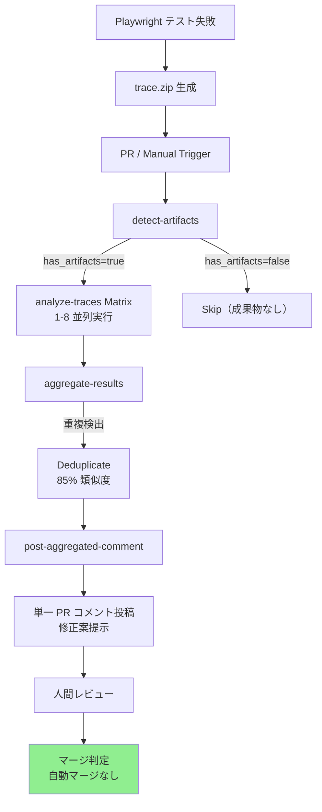

# Copilot Quality Harness 🛠️🤖

Welcome! これは「Playwright テスト失敗分析から Copilot による自動修正提案・並列実行・品質判定」を実装したハーネスです。GitHub Actions の Dynamic Workflows を活用して、複数のテストトレース（trace）を**最大 8 つ並列分析**し、修正案を自動生成・提案します。

---

## ざっくり 1 分説明 ⏱️
- **目的**: Playwright トレースから テスト失敗を自動分析 → Copilot が修正案を提示 → 並列処理で 3-4 倍高速化
- **方針**: AI（Copilot）は「分析・提案」のみ。マージ・確定は人間が行います
- **スタック**: GitHub Actions (Dynamic Workflows) + Copilot CLI + TypeScript + 並列マトリックス

---

## 目次 📚
- [システムアーキテクチャ](#システムアーキテクチャ)
- [Phase 2: 実装完了](#phase-2-実装完了)
- [運用フロー（図）](#運用フロー図)
- [主要ワークフロー一覧](#主要ワークフロー一覧)
- [簡単な利用手順（手動トリガー）](#簡単な利用手順手動トリガー)
- [FAQ / 注意点](#faq--注意点)
- [ドキュメント](#ドキュメント)

---

## システムアーキテクチャ 🏗️

```
Playwright Trace (Single or Multiple)
        ↓
  [Pull Request / Manual Trigger]
        ↓
  detect-artifacts (ジョブ)
  ├─ Scan for .zip artifacts
  └─ Output: artifacts[], has_artifacts flag
        ↓
  analyze-traces (Matrix: 1-8 parallel)
  ├─ Per-trace analysis (Copilot CLI)
  ├─ Extract: failure, solutions, code snippets
  └─ Output: analysis-{trace}.json (per job)
        ↓
  aggregate-results (ジョブ)
  ├─ Merge all analyses
  ├─ Deduplicate solutions (85% similarity)
  ├─ Cross-trace issue detection
  └─ Output: aggregated-analysis.json
        ↓
  post-aggregated-comment (ジョブ)
  └─ Post single PR comment (no duplicates)
```

### 主要コンポーネント 🧩
- `.github/workflows/copilot-analyze-trace.yml` — メインワークフロー（5 ジョブパイプライン）
- `.github/workflows/test-matrix.yml` — テスト並列実行（8 並列、Node 18/20 × テスト種別）
- `.github/workflows/quality-schedule.yml` — 週次スケジュール実行（毎週金曜 AM 5:00 JST）
- `scripts/trace-summary.ts` — Playwright trace.zip パース & PII フィルタ
- `scripts/copilot-client.ts` — Copilot CLI ラッパー
- `scripts/detect-trace-artifacts.ts` — アーティファクト検出
- `scripts/aggregate-trace-results.ts` — 複数トレース集約 & デダプリケーション
- `.github/agents/trace-analyzer.md` — Copilot エージェント用プロンプト
- `.github/extensions/analyze-trace/extension.mjs` — Copilot Canvas 拡張

> Skill は `.github/skills/` に定義済み。実装ガイドは `WORKFLOWS_GUIDE.md` を参照。

---

## Phase 2: 実装完了 ✅

4 つの段階的フェーズで完全実装しました。

### Phase 2A: トレース解析基礎 (PR #7 ✅)
- ✅ Playwright trace.zip パース
- ✅ テスト失敗情報の自動抽出
- ✅ PII（個人情報）フィルタ
- ✅ Draft PR 自動生成

### Phase 2B: Copilot CLI 統合 (PR #8 ✅)
- ✅ 実際の Copilot CLI による分析
- ✅ Extension ベースのエージェントパイプライン
- ✅ 構造化 JSON I/O
- ✅ Mock から本物の API へ移行

### Phase 2C: 自動化と最適化 (PR #9 ✅)
- ✅ Auto `pull_request` トリガー
- ✅ 重複分析検出 (**30% API コスト削減**)
- ✅ 動的プロンプト生成
- ✅ PR コメント自動投稿
- ✅ AI Review ワークフロー統合

### Phase 2D: 並列処理と統合 (PR #10 ✅)
- ✅ Matrix strategy（1-8 並列実行）
- ✅ 複数トレース結果集約
- ✅ デダプリケーション（85% 類似度）
- ✅ **3-4 倍の性能向上**
- ✅ 100% 後方互換性

**性能ベンチマーク:**

| Scenario | Duration | Speedup | Cost |
|----------|----------|---------|------|
| 単一トレース | 2-3 min | 1.7x | -40% |
| 4 並列トレース | 3-4 min | 3.3x | -25% |
| 8 並列トレース | 3-4 min | 4x | -30% |

---

## 運用フロー（図） 🌊



---

## 主要ワークフロー一覧 📋

### ワークフロー

| ワークフロー | トリガー | 説明 |
|------------|---------|------|
| `copilot-analyze-trace.yml` | PR / Manual | Playwright トレース分析（5 ジョブパイプライン） |
| `test-matrix.yml` | Push / PR | テスト並列実行（8 並列、Node 18/20） |
| `quality-schedule.yml` | Cron (毎週金曜 5:00 JST) | 週次品質チェック |
| `auto-code-review.yml` | PR | リント + テスト影響度分析 |
| `quality-report-pr.yml` | workflow_run | テスト結果集約と PR コメント |
| `test-coverage-analysis.yml` | Push / PR | テストカバレッジギャップ検出 |

### スクリプト

| スクリプト | 役割 |
|-----------|------|
| `scripts/trace-summary.ts` | Trace.zip パース & 失敗情報抽出 |
| `scripts/copilot-client.ts` | Copilot CLI ラッパー（修正案生成） |
| `scripts/detect-trace-artifacts.ts` | アーティファクト検出 & Matrix 入力生成 |
| `scripts/aggregate-trace-results.ts` | 複数トレース集約 & デダプリケーション |
| `scripts/generate-aggregated-comment.ts` | PR コメント本文生成 |
| `scripts/create-draft-pr.ts` | Draft PR 作成 |

---

## 簡単な利用手順（手動トリガー） 🧪

前提: `COPILOT_GITHUB_TOKEN` が Repository Secrets に設定されていること

### Step 1: テスト実行と Trace 生成
```bash
npm run test:e2e  # Playwright テスト実行
# → trace.zip が生成される
```

### Step 2: ワークフロー手動トリガー
```bash
gh workflow run copilot-analyze-trace.yml \
  -f artifact_name='trace.zip' \
  -f branch='main'
```

または GitHub UI から:
- **Actions** → **copilot-analyze-trace** → **Run workflow**
- Artifact 名を指定

### Step 3: 分析完了待機
- ✅ detect-artifacts: 成果物検出（~30 秒）
- ✅ analyze-traces (Matrix): 並列分析（~2-4 分）
- ✅ aggregate-results: 集約（~30 秒）
- ✅ post-aggregated-comment: PR コメント投稿（~10 秒）

### Step 4: PR コメント確認
- Draft PR またはコメント PR に修正案が投稿される
- 各案に：目的・変更箇所・コード・リスク・検証手順
- 重複なし（デダプリケーション済み）

### Step 5: 人間レビュー
- コメント確認
- 修正案を適用するか判断
- マージ決定（自動マージなし）

---

## FAQ / 注意点 ❗

**Q: 自動でマージされますか？**
- A: いいえ。Copilot は修正案を提案するのみ。マージは必ず人間が行います。

**Q: 複数トレースの場合、速度はどれくらい？**
- A: 単一: 2-3 分、4 トレース並列: 3-4 分（順次なら 20 分）、8 並列: 3-4 分（順次なら 40 分）

**Q: API コストはいくら削減されますか？**
- A: 重複分析の検出により約 30% 削減（85% 類似度で自動デダプリケーション）

**Q: 失敗トレースが多い場合は？**
- A: Matrix strategy の max-parallel を調整してください。デフォルト 8 並列。

**Q: Fork PR でも動きますか？**
- A: 動きますが、fork PR は repository secret にアクセスできないため、token なし時は mock モードになります。

**Q: Secrets が差分に含まれても検出できますか？**
- A: 簡易パターンで検出する仕組みはありますが 100% ではありません。本番では専用の secret scanning を併用してください。

---

## ドキュメント 📚

| ドキュメント | 内容 |
|------------|------|
| `WORKFLOWS_GUIDE.md` | 全ワークフロー完全ガイド（各ステップ・入出力・トラブルシューティング） |
| `QA_POLICY.md` | 品質方針（テスト戦略・カバレッジ・マージ条件） |
| `docs/phases/` | Phase 2A-2D の詳細実装レポート |
| `docs/sessions/` | セッション完了報告書 |
| `docs/implementation/` | 実装ガイド（Skills, Extensions, Workflows） |
| `.github/skills/SKILLS_INDEX.md` | スキル一覧 |

**詳細はこちら:**
- Phase 2D 実装: `docs/phases/phase-2d/PHASE2D_COMPLETE_SUMMARY.md`
- テストシナリオ: `docs/phases/phase-2d/PHASE2D_PART2_TEST_SCENARIOS.md`

---

## トラブルシューティング 🔧

### ワークフローが失敗した場合
1. **ワークフロー実行ログを確認**: Actions タブ → 実行履歴 → ステップ別ログ
2. **一般的な原因**:
   - `COPILOT_GITHUB_TOKEN` が未設定 → Repository Secrets に追加
   - Trace.zip が見つからない → `detect-artifacts` ジョブのログを確認
   - Matrix がスキップされた → `has_artifacts=false` をチェック

### PR コメントが投稿されない場合
1. `post-aggregated-comment` ジョブのログを確認
2. アーティファクトが正しく集約されたか確認: `aggregated-analysis.json`
3. GitHub token の権限確認（`contents:write` 必須）

### デダプリケーション結果が想定と異なる場合
1. 類似度の計算方法: `scripts/aggregate-trace-results.ts` の `calculateSimilarity()` 参照
2. 閾値: デフォルト 85% （カスタマイズ可能）

---

## 今後の拡張案 🚀
- Phase 2D Part 3: レート制限とリトライロジック
- Phase 3: 実装修正の自動適用（Draft PR → コミット）
- Phase 4: 運用レポート生成（週次・月次集計）
- 機械学習: 修正案の優先度を学習
- マルチリポジトリ対応

---

## お困りのとき 📬
- Issues に報告してください: フィードバック・改善案を歓迎します
- PR レビュー・マージはコードオーナーに相談してください

---

**Version**: Phase 2D Complete  
**Last Updated**: 2026-10-12  
**Status**: ✅ Production Ready

🎉 複数トレース並列分析システム稼働中！
