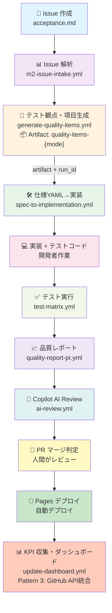
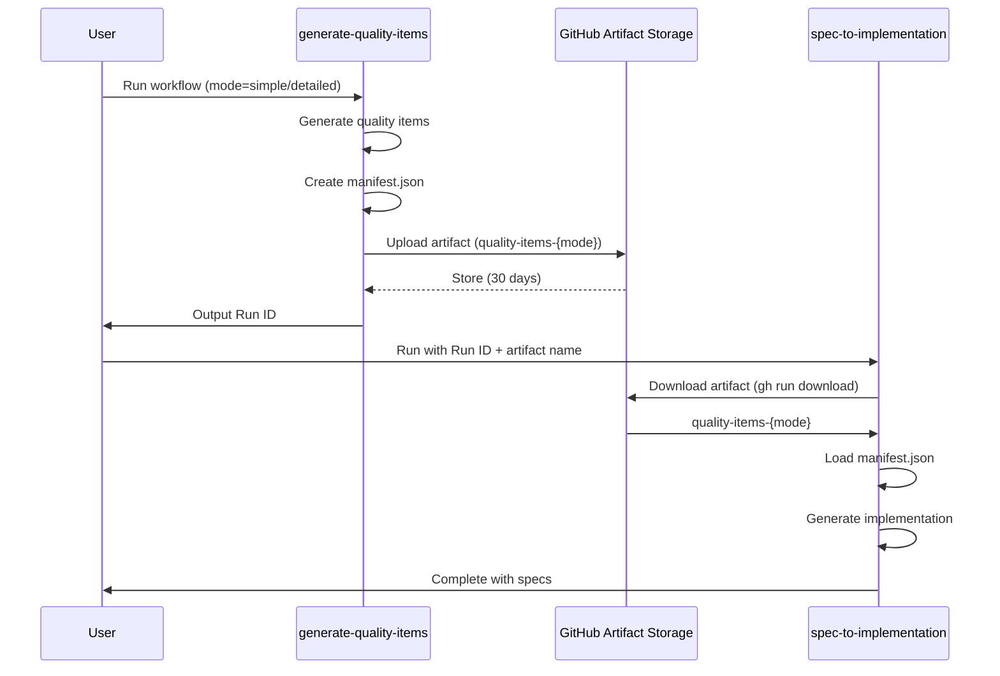
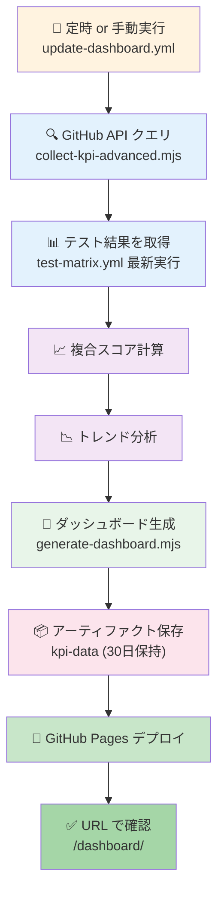

# 🌊 Copilot Quality Harness - 運用フロー完全ガイド

ユーザー視点での完全な「Issue 作成 → テスト設計 → 実装 → テスト実行 → デプロイ」ワークフロー

---

## 📋 全体フロー（ざっくり図）

### 標準フロー



### アーティファクト連鎖（Artifact Chaining）



---

## 🔷 ステップ 1: Issue 作成

### ユーザーの操作

1. **GitHub UI から Issue 作成**
   ```
   Issues → New Issue → Acceptance Test Template を選択
   ```

2. **Issue テンプレート（`.github/ISSUE_TEMPLATE/acceptance.md`）**
   ```markdown
   ## 📝 概要
   What should the system do?
   
   ## ✅ 受け入れ基準（Acceptance Criteria）
   - Criteria 1
   - Criteria 2
   
   ## 🧪 テスト観点（Test Perspectives）
   - Functionality: ...
   - Usability: ...
   - Security: ...
   
   ## 📌 関連リソース
   - Related issues: #xxx
   ```

3. **Issue サンプル**
   ```
   [Issue #100] User Registration Flow
   
   📝 概要: 
   ユーザーが新規登録できる機能が必要
   
   ✅ 受け入れ基準:
   - Email 入力フィールドがある
   - パスワード検証ルール（8文字以上）
   - 送信ボタンが動作する
   - 成功時にメール送信される
   
   🧪 テスト観点:
   - Functionality: Email validation, Password validation
   - Security: SQL injection prevention, XSS prevention
   - Usability: Error messages in Japanese
   ```

---

## 📊 ステップ 2: Issue 自動解析（M2 Issue Intake）

### 自動トリガー（オプション）または手動トリガー

**方法 A: 手動トリガー**
```bash
gh workflow run m2-issue-intake.yml \
  -f issue_number=100
```

**方法 B: GitHub UI**
- Actions → M2 Issue Intake → Run workflow → Issue 番号を入力

### ワークフロー: `m2-issue-intake.yml` ⚡

実行内容:
- Issue コンテンツを読み込み
- リポジトリ構造を自動分析
- テスト設計YAML テンプレを生成
- 出力ファイルを PR コメントに投稿

### 出力例

```json
{
  "issue_number": 100,
  "title": "User Registration Flow",
  "acceptance_criteria": [
    { "id": "AC-1", "description": "Email input field exists" },
    { "id": "AC-2", "description": "Password validation rules (8+ chars)" }
  ],
  "test_perspectives": [
    { "name": "Functionality", "items": ["Email validation", "Password validation"] },
    { "name": "Security", "items": ["SQL injection prevention", "XSS prevention"] }
  ],
  "suggested_spec_yaml": "# Generated specification in YAML format..."
}
```

---

## 🧪 ステップ 3: テスト観点・項目生成（アーティファクト生成）

### 自動生成による テスト観点・項目の定義

**方法 A: 手動トリガー（推奨）**
```bash
gh workflow run generate-quality-items.yml \
  -f mode=simple    # または detailed
```

**方法 B: GitHub UI**
- Actions → Generate Quality Items → Run workflow
- Mode を選択: `simple` または `detailed`

**方法 C: 自動化スクリプト（推奨）**
```bash
.github/scripts/workflow-artifact-chain.sh
```

### ワークフロー: `generate-quality-items.yml` 🎯

実行内容:
- ISO/IEC 25010 品質特性に基づいてテスト観点を生成
- 機能性、信頼性、セキュリティなど複数の観点を自動生成
- JSON + YAML + Manifest JSON 形式で出力
- **GitHub Artifact に保存（30日保持）**
- Run ID をコンソールに出力

### 📦 アーティファクト出力構造

```
Artifact Name: quality-items-{mode}  (e.g., quality-items-simple)
│
├─ manifest.json ⭐ (メタデータ)
│  ├─ version: "1.0"
│  ├─ generated_at: "2026-10-20T05:50:29Z"
│  ├─ workflow_run_id: 39377013016
│  ├─ mode: "simple"
│  ├─ files: { test_perspectives, test_items_yaml, test_items_json }
│  ├─ artifact_name: "quality-items-simple"
│  └─ github_run_url: "https://github.com/cocomomojo/..."
│
├─ test-perspectives-{mode}.json
│  └─ ISO/IEC 25010 品質特性定義
│
├─ test-items-{mode}.yml
│  └─ テスト項目の YAML 仕様
│
└─ test-items-{mode}.json
   └─ テスト項目の JSON 仕様
```

### 実行例 & 出力

```bash
$ gh workflow run generate-quality-items.yml -f mode=simple

# コンソール出力例:
# ✅ Quality Items Generation Complete
# Mode: simple
# Timestamp: 2026-10-20T05:50:29Z
# Generated Files:
# - Test perspectives sheet (JSON)
# - Test items (YAML)
# - Test items (JSON)
# - Manifest (JSON)
#
# Artifact Storage:
# ✅ All files stored in artifact: quality-items-simple
# ✅ Manifest for tracking: manifest.json
# ✅ Retention period: 30 days
```

### アーティファクトの確認

```bash
# ワークフロー実行一覧から Run ID を取得
$ gh run list --workflow generate-quality-items.yml --limit 1
completed  success  Generate Quality Items  main  workflow_dispatch  39377013016  26s

# アーティファクトをダウンロード
$ gh run download 39377013016 --name quality-items-simple --dir ./qa/

# Manifest を確認
$ cat ./qa/manifest.json | jq .

# テスト項目を確認
$ cat ./qa/test-items-simple.yml
```

### 重要: Run ID は次のステップで必要

**Run ID (`39377013016`) を保存**してください！
→ ステップ 4 で `quality_items_run_id` として使用します

---

## 🛠️ ステップ 4: 仕様 YAML → 実装 + テストコード自動生成

### ワークフロー: `spec-to-implementation.yml` 🔧

#### 📥 入力オプション

ワークフロー実行時に以下のいずれかを指定:

**オプション A: ステップ 3 のアーティファクトを使用（推奨）**
```bash
# Run ID と Artifact 名を指定
gh workflow run spec-to-implementation.yml \
  -f spec_file='tests/specs/user-registration.yml' \
  -f quality_items_artifact='quality-items-simple' \
  -f quality_items_run_id='39377013016'
```

**オプション B: spec_file のみ（従来方式）**
```bash
gh workflow run spec-to-implementation.yml \
  -f spec_file='tests/specs/user-registration.yml'
```

**オプション C: Issue から自動生成**
```bash
gh workflow run spec-to-implementation.yml \
  -f issue_number=100
```

**オプション D: 自動化スクリプト（推奨）**
```bash
# ステップ 3 の Run ID を自動取得して実行
.github/scripts/workflow-artifact-chain.sh
```

#### 📥 アーティファクト自動ダウンロード

`quality_items_artifact` と `quality_items_run_id` を指定した場合:

```yaml
- name: Download quality items artifact (if provided)
  if: inputs.quality_items_artifact != '' && inputs.quality_items_run_id != ''
  run: |
    gh run download "${{ inputs.quality_items_run_id }}" \
      --name "${{ inputs.quality_items_artifact }}" \
      --dir qa/quality-items-input
    
    # Manifest を読み込み
    cat qa/quality-items-input/manifest.json
```

ダウンロード後、ワークフロー内で利用可能:
```bash
qa/quality-items-input/
├─ manifest.json
├─ test-perspectives-simple.json
├─ test-items-simple.yml
└─ test-items-simple.json
```

#### 🔧 実装生成ロジック

**事前準備: spec_file を作成（オプション A を使う場合は不要）**
```bash
# tests/specs/user-registration.yml

feature: User Registration
description: Complete user registration flow
tests:
  unit_tests:
    - id: "UT-001"
      title: "Email validation"
      category: "validation"
      input: { email: "test@example.com" }
      expected_output: { valid: true }
    
    - id: "UT-002"
      title: "Invalid email rejection"
      category: "validation"
      input: { email: "invalid-email" }
      expected_output: { valid: false, error: "Invalid email" }
  
  e2e_tests:
    - id: "E2E-001"
      title: "User can register successfully"
      steps:
        - step_id: 1
          action: navigate
          target: "/register"
        - step_id: 2
          action: fill
          target: '[data-test="email-input"]'
          value: "user@example.com"
        - step_id: 3
          action: click
          target: '[data-test="submit-btn"]'
        - step_id: 4
          action: assert_text
          target: '[data-test="success-message"]'
          expected: "Registration successful"
```

**手動トリガー**
```bash
gh workflow run spec-to-implementation.yml \
  -f spec_file='tests/specs/user-registration.yml'
```

### ワークフロー実行内容

1. **仕様 YAML 読み込み**
2. **UT コード自動生成** → `src/tests/unit/user-registration.spec.ts`
3. **E2E テストコード生成** → `e2e/user-registration.spec.ts`
4. **モック定義生成** → `tests/fixtures/mocks.ts`
5. **PR 作成** → ブランチ: `feature/spec-generated-tests-{timestamp}`

### 生成されるファイル例

**UT コード** (`src/tests/unit/user-registration.spec.ts`):
```typescript
import { validateEmail } from '../src/auth';

describe('Email Validation', () => {
  test('UT-001: Valid email is accepted', () => {
    const result = validateEmail('test@example.com');
    expect(result).toEqual({ valid: true });
  });

  test('UT-002: Invalid email is rejected', () => {
    const result = validateEmail('invalid-email');
    expect(result).toEqual({ 
      valid: false, 
      error: 'Invalid email' 
    });
  });
});
```

**E2E テストコード** (`e2e/user-registration.spec.ts`):
```typescript
import { test, expect } from '@playwright/test';

test.describe('User Registration', () => {
  test('E2E-001: User can register successfully', async ({ page }) => {
    await page.goto('http://localhost:3000/register');
    await page.locator('[data-test="email-input"]').fill('user@example.com');
    await page.locator('[data-test="submit-btn"]').click();
    await expect(page.locator('[data-test="success-message"]'))
      .toContainText('Registration successful');
  });
});
```

---

## 💻 ステップ 5: 開発者による実装

### 開発者の作業内容

1. **生成された PR をチェック**
   ```bash
   git checkout feature/spec-generated-tests-{timestamp}
   ```

2. **生成されたテストコードを確認**
   ```bash
   npm run test  # UT を実行
   npm run test:e2e  # E2E テストを実行（まだ失敗するはず）
   ```

3. **実装を完成させる**
   ```bash
   # src/auth.ts を実装して、テストをパスさせる
   ```

4. **ローカルで検証**
   ```bash
   npm run test  # すべての UT がパス
   npm run test:e2e  # すべての E2E テストがパス
   npm run lint  # コード品質チェック
   ```

5. **PR を main へマージ提案**
   ```bash
   git add .
   git commit -m "feat: implement user registration flow"
   git push origin feature/spec-generated-tests-{timestamp}
   ```

---

## ✅ ステップ 6: テスト実行と品質検証

### 自動トリガー: PR 作成時

**ワークフロー: `test-matrix.yml`** 🚀

実行内容:
- Node 18/20 上で テスト実行
- 最大 8 並列マトリックス（異なるテスト種別）
- UT + E2E テスト実行
- テストカバレッジ収集

```yaml
# ワークフローの matrix 戦略
matrix:
  node-version: [18, 20]
  test-type: [unit, e2e, integration]
# 結果: 6 並列ジョブ（2 × 3）
```

### 出力アーティファクト

```json
{
  "test-results-node18-unit.json": { "passed": 45, "failed": 0, "duration": "2.3s" },
  "test-results-node18-e2e.json": { "passed": 12, "failed": 0, "duration": "15.4s" },
  "test-results-node20-unit.json": { "passed": 45, "failed": 0, "duration": "2.1s" },
  "coverage-summary.json": { "lines": 92, "branches": 85, "functions": 90 }
}
```

---

## 📈 ステップ 7: 品質レポート生成と PR コメント

### ワークフロー: `quality-report-pr.yml`

**トリガー**: `test-matrix.yml` 完了時（workflow_run）

実行内容:
1. テスト結果アーティファクト ダウンロード
2. 結果を集約・整理
3. PR コメント生成
4. PR にコメント投稿

### PR コメント例

```markdown
## ✅ Quality Report

### Test Results
| Test Type | Node 18 | Node 20 | Status |
|-----------|---------|---------|--------|
| Unit Tests | ✅ 45/45 | ✅ 45/45 | PASS |
| E2E Tests | ✅ 12/12 | ✅ 12/12 | PASS |

### Coverage
- Lines: 92% (target: 80%) ✅
- Branches: 85% (target: 75%) ✅
- Functions: 90% (target: 80%) ✅

### Performance
- UT Duration: 2.1-2.3s
- E2E Duration: 15.4s
- Total: ~30s (8 parallel jobs)

### Recommendations
- No issues detected ✅
- Ready to merge
```

---

## 🤖 ステップ 8: Copilot AI Review

### ワークフロー: `ai-review.yml`

**トリガー**: PR 作成時

実行内容:
1. 変更ファイル・diff を分析
2. セキュリティリスク検出
3. テストカバレッジギャップ検出
4. 最適化提案生成
5. PR に AI コメント投稿

### AI コメント例

```markdown
## 🤖 AI Code Review

### Security Analysis
- ✅ SQL injection risk: Not detected
- ✅ XSS vulnerability: Not detected
- ⚠️ CORS policy: Needs review (added Access-Control-Allow-Origin header)

### Performance
- ✅ Algorithm complexity: O(n) - acceptable
- ⚠️ Database queries: Consider caching for repeated lookups

### Test Coverage
- ✅ New code coverage: 92% (exceeds 80% target)
- ⚠️ Edge cases: Missing test for empty email input

### Recommendations
1. Add test case for empty email string: `validateEmail("")`
2. Consider memoizing email validation regex for performance

**Confidence**: 8.5/10
```

---

## 🔀 ステップ 9: PR マージ判定（人間レビュー）

### レビュアーのチェックリスト

```markdown
## マージ前チェックリスト

- [ ] コード品質
  - [ ] Lint パス
  - [ ] セキュリティ警告なし
  - [ ] AI Review 確認

- [ ] テスト
  - [ ] UT すべてパス
  - [ ] E2E すべてパス
  - [ ] カバレッジ基準達成（80%+）

- [ ] ドキュメント
  - [ ] README 更新（必要な場合）
  - [ ] CHANGELOG 更新

- [ ] パフォーマンス
  - [ ] テスト実行時間が合理的範囲
  - [ ] E2E 実行時間が許容範囲

- [ ] ビジネス
  - [ ] 要件を満たしている
  - [ ] 受け入れ基準すべて達成
  - [ ] 既存機能への影響なし
```

### マージ判定基準

| 項目 | 条件 |
|------|------|
| **テスト結果** | 全テストパス（Node 18/20 両方） |
| **カバレッジ** | Lines 80% 以上、Branches 75% 以上 |
| **AI Review** | セキュリティ: Low 以下、スタイル: 承認可 |
| **人間レビュー** | 最低 1 人の承認 |
| **自動マージ** | **なし**（必ず手動マージ） |

---

## 🚀 ステップ 10: Pages デプロイ（自動）

### トリガー: main ブランチへのマージ時

**ワークフロー**: GitHub Pages デプロイ（別途カスタマイズ）

実行内容:
1. ビルド実行
   ```bash
   npm run build
   ```

2. デプロイアーティファクト生成

3. GitHub Pages にデプロイ

### デプロイ確認

```bash
# Pages URL
https://cocomomojo.github.io/copilot-quality-harness/

# ダッシュボード（自動生成）
https://cocomomojo.github.io/copilot-quality-harness/dashboard.html
```

---

## 📊 ワークフロー相互関係マッピング表

| # | ワークフロー | トリガー | 入力 | 🎁 アーティファクト出力 | 次ステップ | 依存 |
|---|------------|---------|------|------|-----------|------|
| 1 | m2-issue-intake | Manual（workflow_dispatch） | Issue # | M2 Report JSON | generate-quality-items | - |
| 2 | **generate-quality-items** | Manual（workflow_dispatch） | Mode (simple/detailed) | **`quality-items-{mode}`**<br/>→ manifest.json<br/>→ test-*.yml/json | Manual: spec-to-implementation <br/> + Run ID 保存 | - |
| 3 | **spec-to-implementation** | Manual / Cron | **quality_items_artifact** + **quality_items_run_id**<br/>+ Spec YAML<br/>OR issue_number | UT/E2E/Mock コード + PR<br/> + **manifest.json** | test-matrix（自動） | generate-quality-items (optional) |
| 4 | test-matrix | PR / Push | コード | test-results-*.json | quality-report-pr | - |
| 5 | quality-report-pr | workflow_run（test-matrix 完了） | Artifacts | PR コメント | ai-review（自動） | test-matrix |
| 6 | ai-review | PR created/sync | PR diff | AI コメント | Manual: PR マージ | - |
| 7 | auto-code-review | PR | コード | Lint/Style コメント | Manual: PR マージ | - |
| 8 | (Manual Merge) | Manual | PR | - | Pages デプロイ | ai-review + 人間承認 |
| 9 | Pages Deploy | Push to main | ビルド成果物 | Pages URL | - | main ブランチ |
| 10 | quality-schedule | Cron（毎週金曜 5:00 JST） | - | 週次品質レポート | Dashboard 更新 | - |
| 11 | copilot-analyze-trace | Manual / PR | trace.zip | 分析 + Draft PR | Manual: PR マージ | - |

### 📌 アーティファクトチェーン仕様

**ステップ 2 → 3 への受け渡し**:

1. `generate-quality-items.yml` 実行後、**Run ID を記録**
   ```bash
   $ gh workflow run generate-quality-items.yml -f mode=simple
   # 出力: Run ID = 39377013016
   ```

2. `spec-to-implementation.yml` 実行時、Run ID と Artifact 名を指定
   ```bash
   $ gh workflow run spec-to-implementation.yml \
       -f quality_items_artifact='quality-items-simple' \
       -f quality_items_run_id='39377013016' \
       -f spec_file='tests/specs/user-registration.yml'
   ```

3. ワークフロー内で **自動ダウンロード** + manifest 検証
   ```yaml
   - run: |
       gh run download ${{ inputs.quality_items_run_id }} \
         --name ${{ inputs.quality_items_artifact }} \
         --dir qa/quality-items-input
       cat qa/quality-items-input/manifest.json
   ```

4. **Retention Policy**: 30日間保持（GitHub Actions デフォルト）

**詳細**: [.github/WORKFLOW_ARTIFACT_GUIDE.md](/.github/WORKFLOW_ARTIFACT_GUIDE.md) 参照

---

## 🎯 デフォルト・推奨運用フロー（3 パターン）

### パターン A: 標準的な機能開発（推奨）

```
1. Issue 作成（acceptance.md）
   ↓
2. m2-issue-intake 実行（手動）
   ↓
3. generate-quality-items 実行（手動）→ テスト観点確認
   ↓
4. テスト仕様 YAML 作成/修正
   ↓
5. spec-to-implementation 実行（手動）→ PR 作成
   ↓
6. 開発者: ローカルで実装 + テスト確認
   ↓
7. test-matrix（自動）→ quality-report-pr（自動）
   ↓
8. ai-review（自動）で AI コメント確認
   ↓
9. 人間レビュー → マージ（手動）
   ↓
10. Pages デプロイ（自動）
```

### パターン B: ホットフィックス（高速）

```
1. Issue 作成（簡潔）
   ↓
2. 開発者: 直接実装
   ↓
3. PR 作成 → test-matrix（自動）
   ↓
4. ai-review（自動）
   ↓
5. 迅速レビュー + マージ（手動）
   ↓
6. Pages デプロイ（自動）
```

### パターン C: テスト失敗分析（Trace ベース）

```
1. E2E テスト失敗 → trace.zip 生成
   ↓
2. copilot-analyze-trace 実行（手動/自動）
   ↓
3. Copilot が修正案生成 → Draft PR
   ↓
4. 人間レビュー → 修正実装
   ↓
5. test-matrix（自動）
   ↓
6. マージ（手動）
```

---

## 💡 ベストプラクティス

### ✅ DO

- **Issue は詳しく書く**: テスト観点・受け入れ基準を含める
- **テスト仕様 YAML を活用**: 自動生成に活かせる
- **AI コメントをレビュー**: セキュリティ観点をチェック
- **マージ前チェックリストを確認**: 品質基準達成を確認
- **週次スケジュール実行**: quality-schedule.yml で品質監視

### ❌ DON'T

- **AI コメントだけでマージしない**: 人間レビューは必須
- **テスト不要と判断しない**: 自動生成テストだけでなく、追加の検証も検討
- **自動マージに頼らない**: すべて手動マージ
- **アーティファクト受け渡しを無視しない**: workflow_run の設定を確認
- **PII（個人情報）を含める**: pii-filter.ts で自動除去

---

## 🔍 トラブルシューティング

### アーティファクト・チェーン関連

#### Q: spec-to-implementation でアーティファクトがダウンロードできない

**A**: 以下を確認
```bash
# 1. Run ID が正確か確認
gh run list --workflow generate-quality-items.yml --limit 1

# 2. アーティファクト名が正確か確認
gh run list-artifacts --run 39377013016

# 3. workflow_dispatch が定義されているか確認
cat .github/workflows/generate-quality-items.yml | grep -A 5 "on:"

# 4. 手動でダウンロードテスト
gh run download 39377013016 --name quality-items-simple --dir /tmp/test/
ls -la /tmp/test/manifest.json
```

#### Q: manifest.json が見つからない（アーティファクトは存在）

**A**: generate-quality-items ワークフローが完全に実行されているか確認
```bash
# ワークフロー実行ログを確認
gh run view 39377013016 --log

# 以下のステップが完了していることを確認:
# ✓ Generate metadata
# ✓ Upload artifacts
```

#### Q: アーティファクトの保持期間を超過した

**A**: アーティファクトは 30 日間保持（[.github/workflows/generate-quality-items.yml](/.github/workflows/generate-quality-items.yml) で設定可能）
```bash
# アーティファクト一覧で保持期間を確認
gh run list-artifacts --run 39377013016 --json expiresAt

# 古いアーティファクトを削除
gh run list-artifacts --run <OLD_RUN_ID> --json id --jq '.[].id' | xargs -I {} gh api repos/cocomomojo/copilot-quality-harness/actions/artifacts/{} -X DELETE
```

### その他のワークフロー関連

#### Q: test-matrix が実行されない

**A**: 以下を確認
```yaml
# .github/workflows/test-matrix.yml の on: セクション
on:
  push:
    branches: [ main, develop ]
  pull_request:
    branches: [ main ]
```

### Q: quality-report-pr のコメントが投稿されない

**A**: workflow_run の設定確認
```yaml
on:
  workflow_run:
    workflows: ["Test Matrix"]  # 正確なワークフロー名
    types: [completed]
```

### Q: Pages デプロイが失敗する

**A**: リポジトリ設定確認
- Settings → Pages → Source: GitHub Actions に設定
- ブランチ保護ルールが main ブランチに適用されているか確認

---

## 📊 ステップ 10: リアルタイム品質ダッシュボード（Pattern 3）

### ワークフロー: `update-dashboard.yml` 📊

GitHub API を統合した**リアルタイム KPI 収集とダッシュボード生成**

#### 🎯 機能

**Pattern 3 実装** により以下を自動実行:

1. **GitHub API からテスト結果を取得** (`collect-kpi-advanced.mjs`)
   - 最新の test-matrix.yml 実行結果を自動分析
   - テスト合格率、テスト数、失敗数を抽出
   - コードカバレッジデータを検出

2. **複合スコア計算（AI 危険度ランク）**
   ```
   Composite Score = 
     (Pass Rate × 0.40) +      // テスト品質: 40%
     (Coverage × 0.30) +       // コードカバレッジ: 30%
     (Test Volume × 0.20) +    // テスト数: 20%
     ((100 - Failure Rate) × 0.10)  // 信頼性: 10%
   
   ランク判定:
   - A: 95+ (LOW risk)
   - B: 80-94 (MEDIUM risk)
   - C: 70-79 (HIGH risk)
   - D: 50-69 (VERY HIGH risk)
   - E: <50 (CRITICAL risk)
   ```

3. **トレンド分析**
   - 前回データとの比較
   - IMPROVING / DECLINING / STABLE の判定
   - 90 日間の履歴管理

4. **リアルタイムダッシュボード生成**
   - 日本語UI
   - テスト合格率推移グラフ
   - AI 危険度ランク表示
   - リスクレベルバッジ

5. **GitHub Pages への自動デプロイ**
   - 毎日 10:00 AM JST に実行
   - URL: `https://cocomomojo.github.io/copilot-quality-harness/dashboard/`

#### 📥 実行方法

**手動実行**:
```bash
gh workflow run update-dashboard.yml --ref main
```

**スケジュール実行** (毎日 10:00 AM JST):
```yaml
on:
  schedule:
    - cron: '0 1 * * *'  # UTC 01:00 = JST 10:00
```

#### 📊 ダッシュボード表示内容

| フィールド | 説明 | 例 |
|-----------|------|-----|
| テスト合格率 | pass_rate | 92% |
| テスト実行数 | test_count | 150 |
| コードカバレッジ | coverage | 85% |
| AI 危険度ランク | ai_danger_rank | B |
| **複合スコア** | composite_score | 57/100 |
| **リスクレベル** | risk_level | HIGH |
| **トレンド** | trend | STABLE |
| データソース | data_source | GITHUB_API |

**太字** = Pattern 3 新フィールド

#### 🔄 処理フロー



#### 🔍 KPI データの保存先

**リアルタイム (アーティファクト)**:
```
qa/dashboard-data/latest-kpi.json        # 最新 KPI
qa/dashboard-data/kpi-history.json       # 90日間の履歴
```

**ダッシュボード**:
```
docs/dashboard/index.html                # ダッシュボード HTML
docs/dashboard/data/latest-kpi.json      # 表示用 KPI データ
```

#### 🛠️ トラブルシューティング

**Q: Dashboard にデータが表示されない**

A: ワークフロー実行ログを確認
```bash
gh run list --workflow update-dashboard.yml --limit 1
gh run view <RUN_ID> --log | grep -A 5 "collect-kpi-advanced"
```

**Q: GitHub API エラーが出ている**

A: FALLBACK 値が使用されています（不要な警告）
```bash
# デフォルト値で動作していることを確認
cat qa/dashboard-data/latest-kpi.json | grep data_source
# → "data_source": "FALLBACK" または "GITHUB_API"
```

**Q: コードカバレッジが 0% と表示される**

A: Coverage ファイルの場所を確認
```bash
# GitHub Actions のログで以下を探す:
# "📈 Reading coverage data..."
# "Coverage data not found, using default"

# Coverage ファイルの場所を変更する場合は
# scripts/collect-kpi-advanced.mjs の COVERAGE_PATHS を編集
```

---

## 📚 関連ドキュメント

- [WORKFLOWS_GUIDE.md](./WORKFLOWS_GUIDE.md) — 各ワークフロー詳細
- [.github/skills/](./github/skills/) — Copilot Skills 定義
- [QA_POLICY.md](./QA_POLICY.md) — 品質ポリシー
- [README.md](./README.md) — システム概要
- [Dashboard](https://cocomomojo.github.io/copilot-quality-harness/dashboard/) — リアルタイムダッシュボード

---

**Version**: 1.1  
**Last Updated**: 2026-10-20  
**Maintainer**: copilot-quality-team
