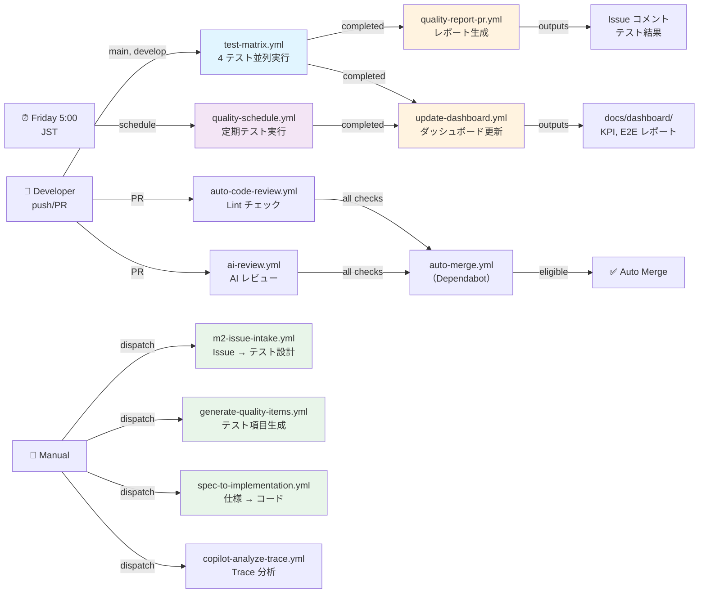
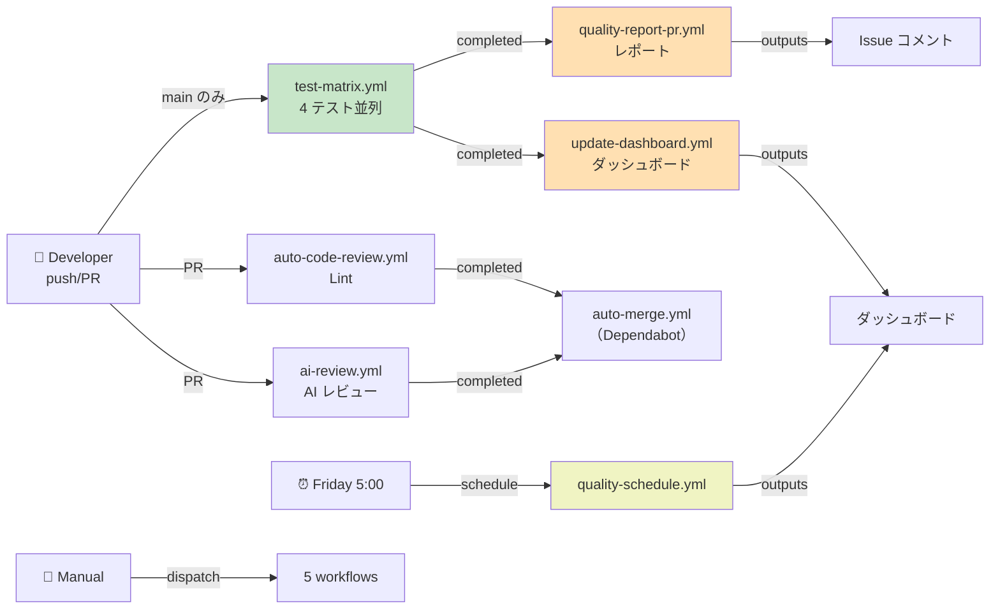

# Workflow 依存関係マップと実行フロー

## 概要

本ドキュメントは、Copilot Quality Harness の 12 個の GitHub Actions ワークフローの依存関係、トリガー条件、実行フローを明確化したものです。

このマップにより、以下の課題を解決します：
- ✅ ワークフローの過度な実行を防止
- ✅ 依存チェーンの最適化
- ✅ 循環依存の排除
- ✅ 必要なトリガー条件の明確化

---

## ワークフロー一覧と分類

### 1️⃣ 自動テスト実行系

| # | Workflow | トリガー | 説明 | 実行頻度 |
|---|----------|---------|------|---------|
| 1 | **test-matrix.yml** | `push` (main, develop)<br>`pull_request`<br>`workflow_dispatch` | 単体/API/E2E テストを並列実行（Node 20、4 種テスト×並列） | 頻繁 |
| 2 | **test-coverage-analysis.yml** | `push` (main)<br>`pull_request` | カバレッジ分析 | 頻繁 |
| 3 | **quality-schedule.yml** | `schedule` (金 5:00 JST)<br>`workflow_dispatch` | 定期実行テスト（全テストスイート） | 週 1 回 |

### 2️⃣ レポート生成系（テスト結果を処理）

| # | Workflow | トリガー | 説明 | 入力 |
|---|----------|---------|------|------|
| 4 | **quality-report-pr.yml** | `workflow_run`<br>  → `Test Matrix` (completed) | テスト結果から品質レポート PR コメントを生成 | test-matrix 成功時 |
| 5 | **update-dashboard.yml** | `workflow_dispatch`<br>`workflow_run`<br>  → `Quality Schedule`, `Test Matrix`, `Quality Report PR` (completed) | KPI データと E2E レポートを集約、ダッシュボード更新 | 複数ワークフロー完了時 |

### 3️⃣ コード品質チェック系（PR 対象）

| # | Workflow | トリガー | 説明 | 実行頻度 |
|---|----------|---------|------|---------|
| 6 | **ai-review.yml** | `pull_request` types: [opened, synchronize, reopened, ready_for_review, edited] | AI による PR レビュー（Copilot CLI） | PR 更新時 |
| 7 | **auto-code-review.yml** | `pull_request` types: [opened, synchronize, reopened, ready_for_review, edited] | Lint チェック + コード品質スコア | PR 更新時 |
| 8 | **auto-merge.yml** | `pull_request` types: [opened, synchronize, ready_for_review]<br>`check_suite` (completed) | テスト成功なら PR を自動マージ（Dependabot 向け） | チェック完了時 |

### 4️⃣ 手動実行系（manual workflow_dispatch）

| # | Workflow | トリガー | 説明 | 用途 |
|---|----------|---------|------|------|
| 9 | **m2-issue-intake.yml** | `workflow_dispatch` | Issue からテスト設計を自動生成 | Issue ベース開発 |
| 10 | **generate-quality-items.yml** | `workflow_dispatch` | テスト項目を生成（simple/detailed） | 品質特性の生成 |
| 11 | **spec-to-implementation.yml** | `workflow_dispatch` | 仕様から実装テストコード自動生成 | TDD フロー |
| 12 | **copilot-analyze-trace.yml** | `workflow_dispatch`<br>`pull_request` (e2e/, playwright.config.js, frontend/*, backend/* 変更時) | Playwright trace から失敗分析 + 修正案提示 | デバッグ用 |

---

## 実行フロー図



---

## 依存関係の詳細

### Chain 1: テスト実行 → レポート生成 → ダッシュボード更新

```
test-matrix.yml (PR, push main/develop)
    ↓ [workflow_run → completed]
quality-report-pr.yml
    ↓ [outputs]
  Issue コメント投稿
    
test-matrix.yml
    ↓ [workflow_run → completed]
update-dashboard.yml
    ↓ [outputs]
  docs/dashboard/ 更新
```

### Chain 2: スケジュール実行 → ダッシュボード更新

```
quality-schedule.yml (金 5:00 JST)
    ↓ [workflow_run → completed]
update-dashboard.yml
    ↓ [outputs]
  docs/dashboard/ 更新
```

### Chain 3: PR トリガー（並列実行）

```
pull_request event
    ├→ auto-code-review.yml (Lint)
    ├→ ai-review.yml (AI レビュー)
    └→ test-matrix.yml (テスト)
    
    ↓ [全チェック完了]
    
check_suite → completed
    ↓
auto-merge.yml (Dependabot PR のみ)
    ↓ [条件満たす]
    ✅ Auto Merge
```

---

## 🔴 問題点と改善候補

### 問題 1: test-matrix と test-coverage-analysis の重複

**現状:**
- `test-matrix.yml`: `push` (main, develop) + `pull_request`
- `test-coverage-analysis.yml`: `push` (main) + `pull_request`
- **結果**: main ブランチへの push で**両方実行**される（重複）

**改善案:**
```
案 A: 統合
  test-matrix に coverage job を追加し、test-coverage-analysis.yml を廃止

案 B: 役割分担
  - test-matrix: PR でのみ実行
  - test-coverage-analysis: main push のみ実行
```

**推奨**: **案 A（統合）** → リソース削減、実行時間短縮

---

### 問題 2: update-dashboard.yml の複数トリガー

**現状:**
```yaml
on:
  workflow_dispatch: {}
  workflow_run:
    workflows: ["Quality Schedule", "Test Matrix", "Quality Report PR"]
    types: [completed]
```

**問題:**
- 3 つのワークフロー完了のたびに実行される
- ただし `concurrency` で 1 つずつ実行（キューイング）
- ≈ **同じダッシュボード更新が 3 回実行される** ⚠️

**改善案:**
```yaml
on:
  workflow_run:
    workflows: ["Test Matrix"]  # ← test-matrix のみに限定
    types: [completed]
  workflow_dispatch: {}
```

**理由**: `test-matrix` → `quality-report-pr` と `update-dashboard` は共に依存しているため、`test-matrix` 完了 1 回でまとめてトリガーすれば OK。

---

### 問題 3: quality-schedule.yml の必要性

**現状:**
- 金曜 5:00 JST に全テスト実行
- `update-dashboard.yml` もトリガーする
- 通常の PR/push でも `test-matrix` が実行されている

**質問:**
- スケジュール実行は何を目的としているか？
  - A. 定期的なリグレッション テスト → **保持すべき**
  - B. 日常的なテストと同じ → **廃止候補**

**推奨方針:**
1. スケジュール実行は **main ブランチ全体の定期検証** という明確な位置づけ
2. ただし `update-dashboard.yml` のトリガー対象から **除外** する
   （テスト成功はダッシュボード更新に直結する必要がないため）

---

### 問題 4: develop ブランチへの push トリガー

**現状:**
- `test-matrix.yml`: `push` (main, develop)
- 開発中に develop へのすべての push がテストを実行

**検討:**
- develop ブランチのテストは PR のみにして、頻度を削減？
- または develop でも同等レベルのテスト実行が必要？

**推奨:**
```yaml
push:
  branches: [main]  # ← develop を削除検討
```

---

### 問題 5: copilot-analyze-trace.yml の PR トリガー

**現状:**
```yaml
on:
  workflow_dispatch:
    ...
  pull_request:
    branches: [main]
    types: [opened, synchronize, reopened]
    paths:
      - 'e2e/**'
      - 'playwright.config.js'
      - 'frontend/**'
      - 'backend/**'
```

**問題:**
- `paths` フィルタが広すぎる（ほぼ全ての PR で実行される）
- 手動実行 workflow なのに、自動 PR トリガーも持つのは珍しい

**推奨:**
```yaml
on:
  workflow_dispatch: {}  # ← manual のみに限定
```

---

## 📊 最適化後のフロー（推奨）



**削減内容:**
- ❌ `test-coverage-analysis.yml` を `test-matrix` に統合
- ❌ `update-dashboard.yml` のトリガー対象から `quality-schedule` 除外
- ❌ `develop` push トリガー削除
- ❌ `copilot-analyze-trace.yml` の PR トリガー削除

---

## 実装チェックリスト

- [ ] `test-matrix.yml` に coverage job を統合
- [ ] `test-coverage-analysis.yml` を廃止
- [ ] `update-dashboard.yml` のワークフロー トリガーを `test-matrix` のみに
- [ ] `quality-schedule.yml` のトリガー対象から `update-dashboard` 除外
- [ ] `test-matrix.yml` の push ブランチを `main` のみに変更
- [ ] `copilot-analyze-trace.yml` の PR トリガーを削除
- [ ] テスト実行確認（PR, push, schedule）
- [ ] ダッシュボード更新が正常に動作確認
- [ ] このドキュメント内容を `README.md` の Workflow セクションに反映

---

## トリガー条件一覧表（参考）

| Workflow | トリガー 1 | トリガー 2 | トリガー 3 | トリガー 4 | 頻度 |
|----------|-----------|-----------|-----------|-----------|------|
| test-matrix | push (main, develop) | pull_request | workflow_dispatch | — | 高 |
| test-coverage | push (main) | pull_request | — | — | 中 |
| quality-schedule | schedule (週 1) | workflow_dispatch | — | — | 低 |
| quality-report-pr | workflow_run (test-matrix ✅) | — | — | — | 中 |
| update-dashboard | workflow_dispatch | workflow_run (3 つ) | — | — | 中 |
| ai-review | pull_request (5 types) | — | — | — | 高 |
| auto-code-review | pull_request (5 types) | — | — | — | 高 |
| auto-merge | pull_request (3 types) | check_suite (✅) | — | — | 中 |
| m2-issue-intake | workflow_dispatch | — | — | — | 低 |
| generate-quality-items | workflow_dispatch | — | — | — | 低 |
| spec-to-implementation | workflow_dispatch | — | — | — | 低 |
| copilot-analyze-trace | workflow_dispatch | pull_request (paths) | — | — | 低 |

---

## 用語辞典

- **workflow_run**: 別のワークフロー完了をトリガーとする（依存フロー）
- **concurrency**: 同時実行数を制限（キューイング）
- **paths**: ファイル変更フィルタ（該当ファイル変更時のみ実行）
- **fail-fast: false**: マトリックスの 1 つが失敗しても他を実行する
- **check_suite**: テスト完了イベント（複数チェックの集約）

---

## 参考

- GitHub Actions ドキュメント: https://docs.github.com/en/actions
- Workflow triggers: https://docs.github.com/en/actions/using-workflows/events-that-trigger-workflows
- Workflow run trigger: https://docs.github.com/en/actions/using-workflows/events-that-trigger-workflows#workflow-run-event-workflow_run
